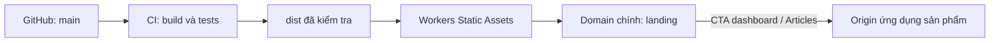

# Nghiên cứu deploy landing trên Cloudflare

Ngày đối chiếu source và tài liệu chính thức: **2026-10-05**. Trạng thái: đề xuất kỹ thuật, chưa triển khai hosting hoặc chuyển DNS.

## Đề xuất

Dùng **Cloudflare Workers Static Assets**, phục vụ `dist/` trên domain chính qua **Custom Domain**. Tận dụng GitHub Actions hiện có để kiểm tra rồi deploy cùng artifact đã kiểm tra. Node chỉ dùng khi build; landing không cần server Node, Docker, database hoặc Astro Cloudflare adapter.

Cloudflare hiện khuyến nghị bắt đầu dự án mới bằng Workers. Đây cũng là lựa chọn phù hợp với repo vì kiểm soát được URL không có dấu `/` cuối và trả 404 cho route không tồn tại. [Cloudflare Pages overview](https://developers.cloudflare.com/pages/), [Astro static deployment](https://developers.cloudflare.com/workers/framework-guides/web-apps/astro/#if-you-have-a-static-site).

Domain chính đã được xác nhận là `signapse.cloud`; app hiện tại ở `https://dev.signapse.cloud`, origin dự kiến khi go-live là `https://dashboard.signapse.cloud`. [Hướng dẫn triển khai](signapse-cloud.md) là runbook hiện hành. Mapping DNS apex phía sau Cloudflare và trạng thái sẵn sàng của app production cần kiểm trước cutover. `example.com` và `app.example.com` dưới đây là ví dụ kiến trúc.



## Điều kiện từ repository

| Source | Hệ quả khi deploy |
| --- | --- |
| [astro.config.mjs](../../astro.config.mjs) | `output: 'static'`, `trailingSlash: 'never'`; giữ `/vi` và `/en` làm URL chuẩn. |
| [Routes](../../src/pages/) | `/` là landing VI noindex; `/vi` và `/en` prerender. Không có API, server route hoặc trang 404 riêng. |
| [package.json](../../package.json), [.node-version](../../.node-version) | Node **24.21.0**, pnpm **10.34.5**, cài bằng frozen lockfile. |
| [Metadata](../../src/lib/landing-metadata.ts) | Canonical, hreflang, social URL và indexability được quyết định tại build time. |
| [App routing](../../src/i18n/routing.ts) | Dashboard và Articles thuộc `PUBLIC_APP_ORIGIN`, không thuộc deployment landing. |
| [CI](../../.github/workflows/ci.yml) | Check, lint, format, build, model và browser tests; manual deploy trên `main` dùng cùng artifact đã kiểm tra. |
| [Browser tests](../../tests/e2e/landing.spec.ts) | VI/EN nhận indexability/public origin của build; kiểm canonical/hreflang. Root tiếp tục noindex. |

## Workers và Pages

| Phương án | Phù hợp với repo | Việc cần xử lý |
| --- | --- | --- |
| **Workers Static Assets — đề xuất** | Upload trực tiếp `dist/`; cấu hình rõ trailing slash và missing route. | Thêm Wrangler config, pin CLI, nối bước deploy vào CI. |
| Cloudflare Pages | Vẫn host được output Astro tĩnh; build `pnpm build`, output `dist`. | Cần 404 ở cấp root để tránh SPA fallback; đối chiếu URL `/vi` với routing thư mục của Pages. |

Pages mặc định coi site không có top-level `404.html` là SPA và phục vụ root cho đường dẫn lạ. Repo có test yêu cầu `/fr` trả 404. Pages cũng chuẩn hóa `about/index.html` thành `/about/`, trong khi contract của landing dùng URL không có slash cuối. [Serving Pages](https://developers.cloudflare.com/pages/configuration/serving-pages/), [Astro on Pages](https://developers.cloudflare.com/pages/framework-guides/deploy-an-astro-site/).

## Cấu hình tối thiểu khi triển khai

Phần cấu hình static assets đã có trong [wrangler.jsonc](../../wrangler.jsonc):

```json
{
  "name": "signapse-landing",
  "compatibility_date": "2026-10-03",
  "assets": {
    "directory": "./dist",
    "html_handling": "drop-trailing-slash",
    "not_found_handling": "none"
  }
}
```

Không có trường `main` vì không chạy Worker script. `drop-trailing-slash` phục vụ cả file HTML và directory index tại URL không có slash cuối. `none` giữ missing route là 404 khi không có script xử lý. [HTML handling](https://developers.cloudflare.com/workers/static-assets/routing/advanced/html-handling/), [Wrangler assets configuration](https://developers.cloudflare.com/workers/wrangler/configuration/#assets).

Wrangler **4.143.0** đã được pin trong devDependencies và lockfile; `pnpm exec wrangler deploy` upload output đã build. Config tĩnh giữ đúng kiến trúc prerender; hướng tự động phát hiện framework của Wrangler có thể cấu hình thêm adapter. [Astro deployment guide](https://developers.cloudflare.com/workers/framework-guides/web-apps/astro/).

## Môi trường và release

Ví dụ các biến **build production**:

```dotenv
PUBLIC_APP_ORIGIN=https://app.example.com
SIGNAPSE_PUBLIC_ORIGIN=https://example.com
SIGNAPSE_LANDING_INDEXABLE=true
SIGNAPSE_VERCEL_ANALYTICS=false
```

`PUBLIC_APP_ORIGIN` phải là origin thực đang phục vụ dashboard/Articles. Nếu trỏ về hostname chỉ host landing, CTA tới `/vi/dashboard` hoặc `/en/articles` sẽ không có destination. Origin không chứa path, query hoặc credentials.

Preview dùng build riêng với `SIGNAPSE_LANDING_INDEXABLE=false`; có thể bỏ `SIGNAPSE_PUBLIC_ORIGIN` để không sinh canonical/hreflang production. Đổi env phải build lại. Worker runtime variables không sửa được HTML/JS đã prerender. Hai Vercel integrations giữ tắt theo cấu hình repo.

**Pipeline ưu tiên: nối deploy vào GitHub Actions đang có.**

1. Run workflow thủ công trên `main`, áp dụng build variables trước `pnpm build`. Checkbox điều khiển indexability; push/PR dùng noindex và không deploy.
2. Giữ install frozen, check/lint/format/build, model tests và browser tests. Assertion VI/EN nhận chế độ build; kiểm canonical/hreflang production, giữ root noindex. `PLAYWRIGHT_APP_ORIGIN`, nếu đặt, phải khớp `PUBLIC_APP_ORIGIN` của build.
3. Sau khi checks pass, deploy chính `dist/` đó bằng Wrangler. Chỉ bước deploy nhận `CLOUDFLARE_API_TOKEN` và `CLOUDFLARE_ACCOUNT_ID`; không deploy từ PR. Nếu tách deploy job thì chuyển artifact từ job kiểm tra, tránh build lại với env khác.
4. Tạo token giới hạn theo account/zone phục vụ landing; token và Account ID lưu trong GitHub Secrets theo workflow hiện tại. Origins công khai lưu trong GitHub Variables; không commit token hoặc đưa token vào browser bundle. [Cloudflare deployment through GitHub Actions](https://developers.cloudflare.com/workers/ci-cd/external-cicd/github-actions/).

**Lựa chọn thay thế: Workers Builds nối trực tiếp GitHub.** Phù hợp nếu muốn quản lý build/preview qua dashboard. Đặt root là repository root, production branch `main`, `NODE_VERSION=24.21.0`, `PNPM_VERSION=10.34.5`, `SKIP_DEPENDENCY_INSTALL=1`; build command `pnpm install --frozen-lockfile && pnpm build`, deploy command `pnpm exec wrangler deploy`. Pin Wrangler trong repo trước khi dùng command này. [Build image](https://developers.cloudflare.com/workers/ci-cd/builds/build-image/), [Build configuration](https://developers.cloudflare.com/workers/ci-cd/builds/configuration/).

Workers Builds trigger từ push. Để giữ release gate khi chọn đường này, ràng buộc merge vào `main` bằng CI đã pass; không mặc định một build thành công ở Cloudflare chứng minh browser suite của GitHub đã pass. Production và preview cần bộ build variables riêng, đặc biệt indexability. Cloudflare có build variables theo từng trigger. [Build trigger configuration](https://developers.cloudflare.com/workers/ci-cd/builds/api-reference/).

## Domain chính và chuyển traffic

Mô hình đề xuất: apex host landing, `www` redirect về apex, ứng dụng sản phẩm dùng origin riêng đã hoạt động. Nếu ứng dụng hiện nằm trên apex, phải chốt đích dashboard/Articles và kế hoạch giữ URL cũ trước cutover. Thay đổi ứng dụng/auth nằm ngoài repo landing.

Custom Domain cần zone active thuộc account triển khai; Cloudflare tạo DNS record và certificate. Nó nhận **mọi path trên hostname**, nên không thể mặc định rằng những path dashboard cũ vẫn đi tới origin trước đó. Cloudflare không cho tạo Custom Domain trên hostname đang có CNAME; xử lý record xung đột tại bước cutover. [Workers Custom Domains](https://developers.cloudflare.com/workers/configuration/routing/custom-domains/).

Trình tự khi có scope triển khai:

1. Xác nhận apex, origin app, account/zone; ghi lại mapping DNS, Worker routes và redirect rules hiện tại để có đường khôi phục. Giữ nguyên records phục vụ mail và subdomain khác.
2. Build/deploy bản noindex lên hostname thử nghiệm; kiểm `/`, `/vi`, `/en`, `/fr`, assets, locale switch và CTA.
3. Kiểm artifact production với HTTPS public origin và indexability bật trước khi chuyển traffic.
4. Trong Worker: **Settings → Domains & Routes → Add → Custom Domain**; gắn apex đã xác nhận và xử lý DNS record cũ của chính hostname này.
5. Với `www`, cấu hình DNS proxied/certificate phù hợp và Redirect Rule chỉ match `www.example.com`, trả 301 về apex, giữ path và query. Đừng dùng rule bao trùm `app.example.com`. [WWW redirect](https://developers.cloudflare.com/rules/url-forwarding/examples/redirect-www-to-root/).
6. Sau khi custom domain hoạt động, đặt `workers_dev: false` trong cấu hình production nếu không cần hostname production phụ. Tắt bằng dashboard rồi bỏ quên config có thể khiến Wrangler bật lại route ở lần deploy sau. Flag này không tắt Version/Preview/Deployment URLs; bảo vệ hoặc vô hiệu hóa các URL production phụ riêng, và giữ preview artifact noindex. [workers.dev configuration](https://developers.cloudflare.com/workers/configuration/routing/workers-dev/).

Request-language negotiation chưa có trong static output. Bản deploy đầu giữ `/` là VI theo contract. Chỉ thêm xử lý request ở edge khi có yêu cầu tự chọn ngôn ngữ; `/vi` và `/en` luôn giữ lựa chọn explicit.

Rollback nội dung bằng redeploy commit trước với env tương ứng. Nếu lỗi ở cutover, tháo Custom Domain và khôi phục mapping hostname đã ghi lại. Cần kiểm tra thao tác này trên account thực khi triển khai.

## Chi phí và kiểm tra sau deploy

Cloudflare miễn phí, không giới hạn requests phục vụ static assets và không thu thêm phí lưu assets. Requests chạy Worker script tính riêng; đề xuất hiện tại không có script. Free plan giới hạn 20.000 files/version, mỗi file tối đa 25 MiB. [Static assets billing](https://developers.cloudflare.com/workers/static-assets/billing-and-limitations/), [Platform limits](https://developers.cloudflare.com/workers/platform/limits/).

Nếu dùng Workers Builds, Free plan có 3.000 build minutes/tháng, một build đồng thời, timeout 20 phút. Khi dùng GitHub Actions, thời gian CI thuộc quota/billing của GitHub; quota Workers Builds không áp dụng cho việc build tại GitHub. [Workers Builds limits](https://developers.cloudflare.com/workers/ci-cd/builds/limits-and-pricing/).

| Kiểm tra trên domain thật | Kết quả cần đạt |
| --- | --- |
| HTTPS/apex/WWW | Certificate hợp lệ; WWW về apex, giữ path/query, không redirect loop. |
| `/`, `/vi`, `/en` | 200; root VI noindex; VI/EN indexable chỉ trên artifact production đã cấu hình. |
| `/vi/`, `/en/` | Redirect về URL không có slash cuối. |
| `/fr`, path không tồn tại | 404 thật, không trả landing với status 200. |
| Canonical/hreflang/social | Hostname production đúng; assets không thiếu; không còn app links localhost. |
| Navigation/demo | Mobile/desktop, locale/query/hash, keyboard, reduced motion và WebGL fallback hoạt động. |
| Dashboard/Articles | URL và locale đúng; kiểm đích thực riêng vì browser tests local intercept app navigation. |

Repo chưa có `robots.txt` hoặc sitemap. Sitemap có thể bổ sung cho `/vi` và `/en` khi triển khai SEO; đây không phải điều kiện để Cloudflare phục vụ landing. `robots.txt` không thay thế noindex trong HTML preview.

## Bằng chứng và phần còn cần xác nhận

Nghiên cứu ban đầu dựa trên source/config/CI/tests và tài liệu Cloudflare. Lượt chuẩn bị triển khai tiếp theo đã dùng toolchain cô lập đúng pin, chạy source checks, 14 model tests, 31 browser tests production, 3 metadata tests preview và 10 endpoint checks trên Wrangler local. [Bằng chứng mới](../verification/cloudflare-release-local.json) phân biệt local checks với hosted CI/deployment. Account/token, DNS cutover và certificate chưa được kiểm trên hosting thật.

Cấu hình deploy đã được chuẩn bị theo [runbook signapse.cloud](signapse-cloud.md): Wrangler, CLI/lockfile, manual release trong workflow và metadata assertions. Khi triển khai cần mapping apex hiện tại, account/zone đích và app ở dashboard đã sẵn sàng. Bằng chứng local không thay thế kiểm hosted account/domain.
